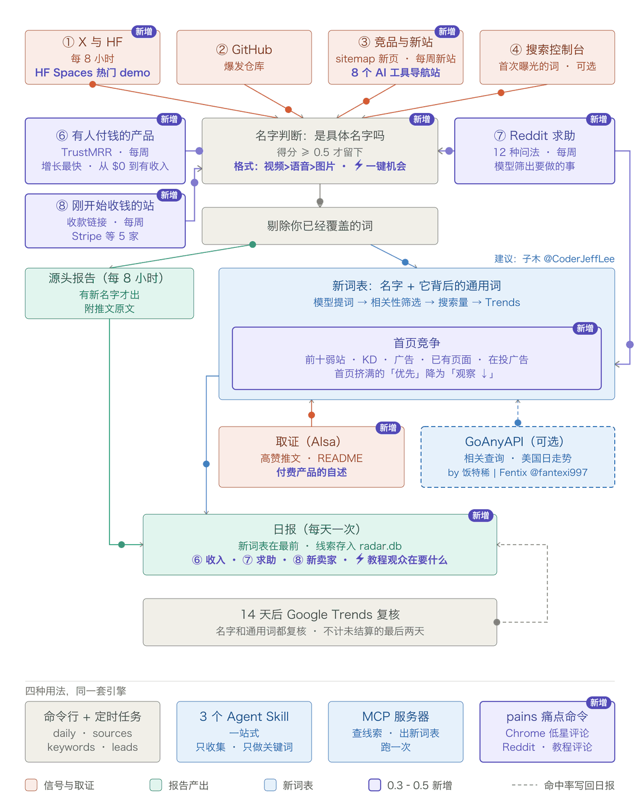

# new-term-radar（新词雷达）

[English](README.md)

**新增 Web 网站机会模式**：先核对真实用户问题，再筛选适合网页解决的任务；支持零推荐、预算检查和同日复用。通过 `opportunities.enabled` 启用，详见 [使用说明](docs/web-opportunities.md)。下面保留原版新词发现和趋势分析说明。

新版以任务检索为入口，单用户需求进入跨日证据池；Qwen 做预处理，Codex 自动任务逐条审核全部来源后发布结论。零结果会展示覆盖范围、待补证任务与处理缺口。原文及搜索意图核验后才查询 Trends，见 [自动任务与审核交接](docs/web-automation.md)。

配置好 Codex 每日自动任务并启用 `google_trends.enabled` 后，还会对入选机会做免费的 Google Trends 网页验证（美国、近 90 天及 12 个月）；无机会不查询，访问失败保留未知，不转付费。单独运行命令行只生成待验证计划，网页核验由 Codex 自动任务完成，详见 [验证步骤](docs/google-trends.md)。旧版 AIsa 趋势接口实际为 DataForSEO Trends 估算，不能作为 Google Trends 原始数据。

每天一份报告，列出 AI 领域里刚开始冒头的名字：新模型、新产品、新工具、新仓库。在它们最早被说出来的地方抓，而不是等关键词工具里有数据再看。

适合围绕新词做页面、写内容、做产品的人：AI 工具站的 SEO、Newsletter、导航站，或者任何想在「Strata」「Seedance」出现当天就知道、而不是两周后才知道的人。

## 为什么做这个

一个新名字会按这个顺序留下痕迹：

1. 实验室或大号在 X 上先说出来；模型进入 Hugging Face 热门榜。
2. GitHub 上某一个仓库自己涨起来。
3. 导航站和竞品给它加页面；有人为它注册域名，新站开始有排名。
4. 你自己的站第一次因为这个词有了搜索曝光。
5. Google Trends 上出现曲线，这已经是几天到几周之后了。

关键词工具读的是第 5 步。这个雷达每天读第 1 到 4 步，第 5 步只用来复盘自己准不准。

它最初就是照着一个例子做的：[Niko1221/Strata](https://github.com/Niko1221/Strata) 创建于 2026-09-24，九天后 7,700 星。9 月 26 日起就有人在搜「niko strata」，而当时没有第二个仓库用这个名字，关键词工具里也查不到。一个仓库每天涨 800 星，这本身就是全部信号，而且是公开的。

## 它读什么



| 信号 | 抓什么 | 需要 | 花费 |
|---|---|---|---|
| ① X | 你关注的账号里，60 天内第一次出现的名字 | AIsa key | 每个账号每次 $0.003 |
| ① Hugging Face | 新进热门榜前 50 的模型；量化版、微调版归到同一个基础名下 | 无 | 免费 |
| ② GitHub 爆发 | 创建不到 14 天、平均每天涨 200 星以上，或比昨天多 400 星的仓库；附带大家实际会搜的写法（「niko strata」） | 无（有 GitHub token 限额更高） | 免费 |
| ③ 竞品 sitemap | 某个站新增的几个网址共用、而它的旧网址里很少出现的词 | 你列出的 sitemap | 免费 |
| ③ 新站 | 近 90 天注册且首次被收录、已经有 20 个以上排名词的域名 | AIsa key | 每个查询约 $0.13，每周一次 |
| ④ Search Console | 你的站第一次获得曝光的查询词（用新鲜数据） | 你自己的 Google 授权 | 免费 |
| ⑤ 复盘 | 每条线索 14 天后去 Google Trends 核对，和它自己的基线比；按信号统计命中率和提前天数 | AIsa key | 每个搜索写法 $0.0012 |
| 新词表 | 针对当天的新名字:找出它背后的通用搜索词(大家拿这个新东西做什么),逐个估算规模并给出决策 | AIsa key；[GoAnyAPI](https://goanyapi.com) key 可选 | 5 个名字约每天 $0.15，加上 GoAnyAPI 约 $0.22 |
| 名字判断 | 小模型给每个词打分：是某个具体东西的名字，还是普通词？ | AIsa key | 每次不到一美分 |

价格是 2026 年 10 月 AIsa 的实际收费。按示例配置（35 个 X 账号、每天读三次，新词表每天读 5 个名字），一个月约 $15：读 X 约 $10，新词表约 $5。少读几个账号或者每天只读一次，费用按比例下降。

## 新词表

只有名字是不够的。「SynthID Detector」作为关键词寿命短，而且是 Google 的；它做的那件事「ai image detector」才是大家会一直搜的词，而且不属于任何人。雷达每天会把新名字再读一遍，把两种词写进同一张表：

```
| 关键词 | 类型 | 来自 | 新词? | 估算日搜 | 开始上涨 | 峰值 vs gpts | 峰值日 | 近 7 天比前 7 天 | 现在 | 决策 |
| **photocraft** | 名字 | — | 是 | 12747 | 2026-10-05 | 97 vs 3.1 | 2026-10-09 | — | 还在涨 | **优先** |
| **claude haiku 5.5** | 名字 | — | 是 | 1863 | 2026-10-07 | 100 vs 23.7 | 2026-10-08 | ×6.0 | 还在涨 | **优先** |
| **ai image detector** | 通用词 | synthid detector | 否 | 2537 | — | 87 vs 31.6 | 2026-10-04 | ×1.2 | 没动 | 观察 |
| **photoshop alternative** ⚠ | 通用词 | photocraft | 否 | 244 | — | 61 vs 61.7 | 2026-10-08 | ×1.8 | 没动 | 跳过 |
```

（2026-10-12 一次真实运行的节选）

它是怎么做出来的（`radar/usecases.py`）：

1. **取证**：搜提到这个名字的高赞帖子（X 高级搜索）；如果是仓库，再读它的 README。
2. **提词**：模型读完证据，针对它看到的每一种用法，写出普通人会搜的关键词，并附上原话作依据。借别的产品名字的写法（「photoshop alternative」）会保留并标 ⚠：需求常常挂在老牌产品上，要不要用别人的品牌由你判断。
   如果配了 GoAnyAPI 的 key（可选，见下），雷达还会取这个名字在 **Google Trends 里的相关查询**：大家实际把什么词和它一起搜。SynthID Detector 拿到的是「ai photo detector」「google ai detector」「ai detector」，这些行带 🔎。包含名字本身的查询列为它的长尾（「photocraft download」「nano banana 2.1 vs pro」）。本身是别的新东西名字的查询（「nano banana 2.1」旁边的「gpt image 2.5」）单独记为线索。
3. **筛选**：再调一次模型，给每个写法打分：这个名字能不能回答这个搜索；同时标出品牌、认出别的东西的名字。关系不够直接的丢掉。Claude Haiku 5.5 提出的 6 个全被筛掉（「ai coding assistant」「github copilot alternative」）；SynthID Detector 的 5 个全部保留。
4. **搜索量**：一次批量查询，取剩下写法的 Google Ads 月搜索量。低于 `min_volume` 的丢掉，大部分都会被丢掉。
5. **Trends**，每行查两次：单独查这个词，得到曲线形状（是不是新词、哪天开始涨、峰值、近 7 天比前 7 天、现在的走势）；和基准词（默认 `gpts`）放在一起查，得到规模。

日搜是估算值。通用词用它自己的 Google Ads 月搜索量，沿它自己的 Trends 曲线推到今天。再用这些词反推出基准词的规模，名字还没有搜索量数据，就对比基准词来估。

决策：**优先** = 近 30 天涨过、现在还在高位、估算日搜不低于 `min_daily`。**观察** = 涨了但规模小，或还太早读不出，或没动但本身有这个规模的稳定需求。**跳过** = 已回落，或没动且规模小。

每个名字读两次：出现当天一次，三天后一次。因为发布当天的帖子都是公告，还看不出用法。通用词也会记进线索库，14 天后和名字一起复盘。

从我们最早跑的 8 个名字看，对它应该有这样的预期：

- **名字涨了；通用词在五天内大多没涨。** PhotoCraft、Claude Haiku 5.5、SynthID Detector 的搜索都明显上升。它们背后的通用词里有一个动了：PhotoCraft 出现后，「photoshop alternative」在美国连续五天比之前高出约 80%。这张表读的全球日数据几乎没反映出来（2、1、1、2、4、2），而另一个来源的美国日数据看得很清楚。所以全球数据显示「没动」，不能证明这个词真的没动。配了 GoAnyAPI 的 key 后，规模较大的行改读单个国家的数据，在那份数据里比之前高 50% 且持续三天算上涨；同一次运行里「photoshop alternative」就显示为 `还在涨 (US)`。
- 这张表今天靠得住的用处，是告诉你**一个新东西对应的是哪个已有需求、这个需求有多大**（「ai image detector」约每天 2,500 次搜索）。通用词会不会跟着名字涨，要等 14 天复盘才知道，我们现在还没有结果。
- 对纯模型发布（Claude Haiku 5.5、Nano Banana 2.1），证据都是公告和跑分，提出来的词很弱（「ai coding assistant」）。对只做一件事的产品和仓库效果更好。
- **Google Trends 最后两天的数据没有结算。** 互不相关的词在这两天会依次返回 0 和 100，看起来像一个尖峰。我们第一遍就是被这个骗了；现在代码里所有读 Trends 的地方都会丢掉这两天，而且上涨必须持续两天才算数。
- Google Ads 的搜索量滞后约两个月。月搜只有几百的词，Trends 基本读不出可靠的数。

### 某个数据源没配或挂了的时候

表照常产出，但会变薄，并且会写明缺了哪一块：

| 情况 | 表里少了什么 | 表下面会出现的一行 |
|---|---|---|
| 没配 `GOANYAPI_API_KEY`（默认就是这样） | 没有 🔎 行、没有名字的长尾、没有「一起被搜的其他名字」、没有 `(US)` 走势。通用词只来自模型，走势全部读全球数据，真实的上涨可能被读成「没动」 | 「相关查询未开启：设置 GOANYAPI_API_KEY 后…」 |
| GoAnyAPI 的 Trends 挂了（接入第一天 2026-10-12 就遇到过） | 这一次运行等同于没配 key | 「相关查询失败：…」和「国家数据获取失败，已退回全球数据：…」 |
| 某个名字的 AIsa 推文搜索失败（2026-10-13 遇到两次超时） | 这个名字的推文证据。仓库还有 README 可用；没有 README 的模型或产品就只剩相关查询，如果又没配 GoAnyAPI，这一天它就没有通用词 | 「推文搜索失败，这次只用了 README 和相关查询：…」 |
| 某个名字既没有推文也没有 README | 它的通用词；名字自己那一行还在 | 「没找到帖子或 README：…」 |
| 当天没有名字得分 0.8 以上的「东西」类线索 | 整张表 | 「今天没有要读的名字…」 |
| AIsa 的搜索量或 Trends 查询失败 | 整张表：这两项没有替代来源 | 表的位置直接显示报错 |

表变薄不等于今天没动静。下结论说「什么都没涨」之前，先看表下面这几行。

把配置写成 `"usecases": {"per_day": 0}`，或者加 `--skip usecases`，可以关掉它。

## 一个必需的 key，一个可选的

所有付费的部分都走 [AIsa](https://go.aisa.one/yansen-zhu)：X 帖子、Google Trends 和域名数据（背后是 DataForSEO）、判断名字的模型。一个 key，按次付费，不用分别订阅 X API 和 DataForSEO。

> 上面是推荐链接：通过它注册是对这个项目的支持。从 aisa.one 任何入口拿到的 key 用起来完全一样。

**可选：`GOANYAPI_API_KEY`**（[goanyapi.com](https://goanyapi.com/r/ga-95708898fb)）从两方面改进新词表，每天约 $0.07：给每个名字加上 Google Trends 的相关查询；名字和规模较大的通用词（月搜 1,000 以上，最多 8 行）的走势，改用单个国家的 30 天日数据来读，这份数据结算到昨天。这些行的「现在」一列后面会标出国家，例如 `还在涨 (US)`。不配这个 key，新词表只用模型提出的写法和全球数据。这个服务很新（2026 年 8 月才发布）；我们测试时每次调用要 20 到 55 秒，大约十次有一次失败，所以雷达会试两次，失败就写在表里，继续往下跑。上面这个也是推荐链接。

没有 AIsa 的 key 时，免费的信号照常运行（Hugging Face、GitHub、sitemap、Search Console），只是报告里所有词不分先后列出，因为没有模型判断哪些是名字。

## 快速开始

需要 Python 3.10 或更高版本。雷达本身只用标准库。

```bash
git clone https://github.com/zhuyansen/new-term-radar
cd new-term-radar
cp config.example.json config.json      # 然后编辑：你的 X 账号、sitemap、主题；想要中文报告把 lang 改成 "zh"
export AISA_API_KEY=...                 # 从 https://go.aisa.one/yansen-zhu 获取；用 AIsa 命令行 `aisa login` 登录过也可以
python -m radar daily --out report.md
```

第一次运行只是建立快照：昨天的 X 词表、星数、sitemap 网址都还没有，所以只会报出 GitHub 爆发仓库（它不依赖昨天的数据）。从第二次运行起，每个信号都会报告变化。

两个命令：

```bash
python -m radar sources --out sources.md           # 只跑 ①：X 和 Hugging Face，每隔几小时跑一次
python -m radar daily --skip x,hf --out report.md  # 其余全部，每天一次
```

`sources` 只在有新名字时才写报告。`daily` 带 `--skip x,hf` 时，会列出 `sources` 在过去 24 小时记下的线索。如果你每天只跑一次，直接用 `python -m radar daily`，什么都不跳过。

其他参数：`--skip` 可选 `x,hf,breakout,sitemaps,newsites,gsc,review,judge,usecases`；`--new-sites` 让每周信号今天就跑；`--mail` 发邮件（见下）；`--state DIR` 指定数据库和快照的目录。

## 报告长什么样

2026-10-12 一次真实运行的节选（中文报告，`"lang": "zh"`）：

```
### 候选新词(判为专有名词的排前面;已覆盖的会标出)

| 词 | 信号 | 名字得分 | 已覆盖 | 搜索变体 | 例子 |
| **gridcraft** | GitHub 爆发 storytold/gridcraft ★3178(均 626/天) | 0.95 | 无 | storytold gridcraft | GridCraft: an open-source, cl… |
| **artex** | GitHub 爆发 mhtsec/ARTEX ★3353(均 825/天) | 0.85 | 无 | mhtsec artex, mht artex | AI 自主渗透测试系统 … |

其他上升词(判为普通词):anatomy, math, iphone use

### ⑤ 复盘(14 天前报出的词,在 Google Trends 里起没起来)

| 词 | 首次报出 | 结论 | 提前天数 |
| strata | 2026-09-25 | hit | 3 |
```

`daily` 还会在 Markdown 旁边写一份 `report.json`，包含生成报告用到的全部数据。

## config.json

| 字段 | 含义 |
|---|---|
| `lang` | `"en"` 或 `"zh"`：报告的语言 |
| `x_accounts` | `labs` 和 `bloggers`：要读的 X 账号。实验室最先说出名字；博主选你这个领域里新词靠谁传开 |
| `sitemaps` | 想看哪些站新增了什么页面。`index` 是一个 sitemap；如果它是 sitemap 索引，用 `shards`（正则）挑要读的子 sitemap。`pause` 是对这个站两次请求之间的秒数。`strip_locale` 去掉 `/en/`、`/zh-CN/` 这类前缀，同一条目的多语言版本只算一次 |
| `topics` | 名称和正则：每个主题单独一节，列出匹配的线索、仓库和查询 |
| `known_terms` | 你已经有页面的词，或者永远不想看到的词。包含它或被它包含的线索会被标出，不进入复盘 |
| `stop_words` | 你这个领域的日常用词，追加到内置列表（内置列表是按 AI 工具领域调的） |
| `judge` | `model`（AIsa 上任意对话模型）和 `min_score`（默认 0.5） |
| `breakout` | `window_days`、`min_stars`、`velocity_min`（每天涨星）、`delta_min`（比昨天多的星） |
| `new_sites` | `queries`：名称和域名的 SQL LIKE 模式（`"%ai%"`），每个是一次付费查询；`weekday`（0 = 周一） |
| `review` | `after_days`（14）和 `per_day`（每天复盘 5 条） |
| `usecases` | 新词表。`per_day`（每天读几个名字，0 = 关闭）、`model`、`benchmark`（用来比规模的基准词）、`min_volume`（写法至少要有的月搜索量）、`min_daily`（判为「优先」所需的日搜）、`recheck_days`（3）、`related`（设了 `GOANYAPI_API_KEY` 时是否用相关查询）、`related_geo`（`US`）、`country_trends`（规模较大的行改读该国数据）、`country_min_volume`（1000）、`country_max`（8） |
| `gsc` | `site`（`sc-domain:example.com`）和 `token_file`。留 `{}` 即关闭 |

添加某个站的 sitemap 之前，请先看它的 robots.txt，`pause` 不要低于它的 crawl-delay。示例配置每天总共几十次请求，按 `pause` 间隔发出。

### Search Console（可选）

```bash
pip install google-auth-oauthlib
python scripts/gsc_auth.py gsc_client.json   # 打开一次浏览器授权，写出 gsc_token.json
```

`gsc_client.json` 是 Google Cloud Console 里类型为「桌面应用」的 OAuth 客户端，所在项目要启用 Search Console API。然后设置 `"gsc": {"site": "sc-domain:你的域名"}`。授权是只读的，凭证只留在你自己的机器上，`.gitignore` 已经把它排除了。

### 邮件（可选）

`--mail` 通过 [Resend](https://resend.com) 发送报告。设置 `RESEND_API_KEY`、`EMAIL_FROM`（你在 Resend 验证过的域名下的地址）和 `RADAR_EMAIL_TO`（多个用逗号分隔）。要 HTML 版需要 `pip install markdown`。

## 在 agent 里用：skill 和 MCP 服务器

### Skill

`skills/` 里有三个 [Agent Skill](https://agentskills.io/home)：一个把整件事做完，另外两个是拆开的两半，给想分开用的人。

| Skill | 做什么 |
|---|---|
| `new-term-radar` | 一次跑完：今天的新名字，加上它们的关键词优先级表。也可以直接给它你已有的名字。从这个开始 |
| `ai-listening` | 把各路信号最近 24 小时的新东西收集起来、去重，出一份名字报告 |
| `seo-new-keywords-research` | 给它名字，或者一段提到这些名字的原始文本，它返回关键词优先级表：每个名字背后的通用词，经过筛选、估算规模并给出决策 |

```bash
npx skills add zhuyansen/new-term-radar
```

在 Claude Code 里，这三个 skill 也可以作为插件安装：

```
/plugin marketplace add zhuyansen/new-term-radar
/plugin install new-term-radar@new-term-radar
```

然后对你的 agent 说「今天有哪些 AI 新词」「出一份 AI listening 报告」或「给 PhotoCraft 和 SynthID Detector 做关键词调研」。skill 会在本机没有这个仓库时把它克隆到 `~/new-term-radar`，在任何付费运行之前先告诉你大概花多少，表不完整时也会说明。

### MCP 服务器

给支持 MCP 的客户端用（Claude Code、Cursor、Claude Desktop）：

```bash
pip install "new-term-radar[mcp] @ git+https://github.com/zhuyansen/new-term-radar"
```

```json
{
  "mcpServers": {
    "new-term-radar": {
      "command": "new-term-radar-mcp",
      "env": {
        "AISA_API_KEY": "...",
        "RADAR_CONFIG": "/绝对路径/config.json",
        "RADAR_STATE": "/绝对路径/state"
      }
    }
  }
}
```

| 工具 | 返回什么 | 花费和耗时 |
|---|---|---|
| `recent_leads` | 雷达记下的线索，带复盘结论和各信号命中率 | 免费，立刻返回 |
| `keyword_table` | 你给的名字的新词表 | 每个名字约 $0.05，每次调用另加 $0.09；每个名字 40 到 90 秒 |
| `run_radar` | 跑一次 `sources` 或 `daily`，返回报告 | 付费，要几分钟。只适合第一次试用，定时运行应该交给 cron 或 Actions |

把 `RADAR_STATE` 指向定时任务写入的那个目录，`recent_leads` 看到的就是定时任务记下的线索。同样的两个功能在命令行里也有：`python -m radar keywords "名字" …` 和 `python -m radar leads`。

## 在 GitHub Actions 上跑

`.github/workflows/radar.yml` 每 8 小时跑一次 `sources`、每天跑一次 `daily`，状态存在 Actions 缓存里，报告写到每次运行的摘要页。默认关闭，需要你主动开启：

1. Fork 这个仓库（私有 fork 也可以）。
2. 把 `config.json` 从 `.gitignore` 里删掉，提交你的配置。配置里没有任何密钥。
3. 添加 secret `AISA_API_KEY`；可选 `GOANYAPI_API_KEY`、`RESEND_API_KEY`、`EMAIL_FROM`、`RADAR_EMAIL_TO`、`GSC_TOKEN_JSON`。
4. 把仓库变量 `RADAR_ENABLED` 设为 `true`。

## 各部分怎么判断

- **帖子里的名字**（`radar/terms.py`）：首字母大写的词、带数字的词（`Qwen3.8`）、中间有大写的词（`HyperFrames`）；名字后面的数字会并进去（`Opus 5.5`）。两个账号都用过的名字算数；只有一个账号用的，需要 100 个赞，而且必须明显是名字，因为首字母大写的词常常只是句子开头。
- **sitemap 里的上升词**：按不同网址计数，并和这个站自己的基线比，所以一个长网址造不出一波假信号。
- **名字判断**（`radar/judge.py`）：每 25 个词一次模型调用，每个词附带最多三处出现的原文。调用失败时报告照常发出，只是不排序。
- **复盘**（`radar/review.py`）：一个搜索写法在我们报出之后的峰值，超过它自己之前基线的 2 倍且高出 10 点，才算「涨了」。有旧含义的词（「strata」：岩层、分契式产权）基线本来就高，不算；「niko1221 strata」从 0 涨起来才算。Trends 没结算的最后两天不计入。

## 实测过什么，没测过什么

- 名字判断（`gpt-4.1-mini`）：拿我们自己日常使用中、之前的判断器放行的 170 个词重新判了一遍，它同意其中 149 个。它拒掉的 21 个里，大部分是之前误放的噪音（sitemap 路径碎片如 `io.github.wxt invoice`、`asd`），真正漏掉的名字大约 3 个（`synthid detector`、`veo`、`v4.1 flash`），而且这次测试给它的上下文比实际运行时少。40 个普通词（`dashboard`、`pricing`、`today`）没有一个被放行。
- 各信号的命中率：还没有。复盘每条线索要等 14 天，我们的才刚开始。唯一一条手工放进去的检查是 Strata，结论是命中，比 Trends 曲线起来早 3 天。你自己的报告会随时间显示你的数字；在那之前，任何信号都应当视为未经验证。
- X 信号的好坏取决于账号名单。你的账号都没提到的名字，它看不到。

## 已知问题

- **新站（2026-10-12）**：AIsa 对 `post_dataforseo_domains_whois_overview_live` 的参数校验目前会拒绝 DataForSEO 要求的筛选格式，所以这个信号会报错，报告的其余部分不受影响。2026-10-06 之前是正常的。上游修复之前可以用 `--skip newsites` 关掉。
- 内置停用词和 Hugging Face 名字清洗是按 AI 模型和 agent 工具领域调的。换领域请加 `stop_words`。
- 报告里没有搜索量。雷达只告诉你一个名字是新的；给它建页面之前，请自己查搜索量和搜索结果前排的页面形态。

## 开发

```bash
pip install pytest markdown
python -m pytest -q tests
```

测试覆盖逻辑部分（名字提取、打分、存储、报告），不访问网络。

## 致谢

- [子木 @CoderJeffLee](https://x.com/CoderJeffLee)：新词表的想法来自他的建议，新名字和它下游的通用词应该放在同一张表里，每行给出决策。
- [饭特稀 | Fentix @fantexi997](https://x.com/fantexi997)：[GoAnyAPI](https://goanyapi.com)，相关查询和单个国家 Trends 走势这个可选数据源。

流程图由 `docs/make_diagram.py` 生成（需要 `rsvg-convert` 和 `ffmpeg`）。

## 许可

MIT。这套雷达提取自 [agentskillshub.top](https://agentskillshub.top) 背后每天在跑的版本。
